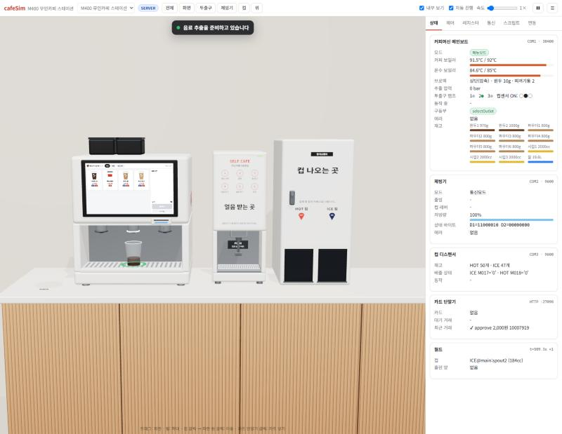
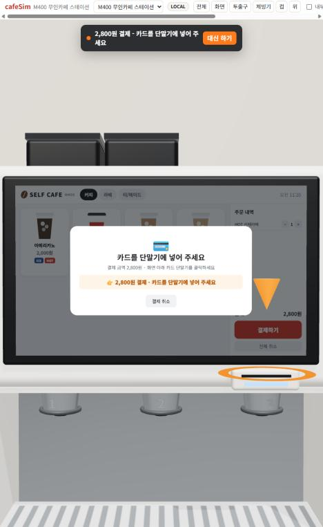
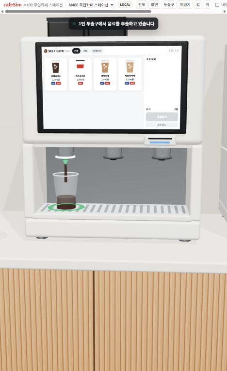
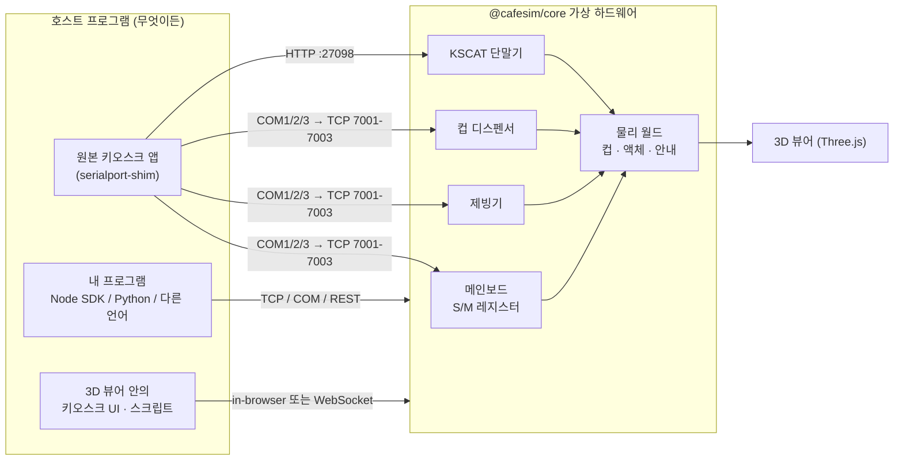
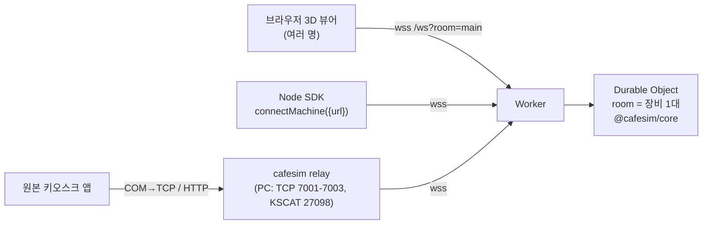

# cafeSim: M400 무인카페 3D 하드웨어 시뮬레이터

커피머신(3 투출구, 터치스크린, 카드 단말기), 제빙기, 컵 디스펜서로 구성된 **M400 무인카페 스테이션**을
3D로 재현한 가상 하드웨어 플랫폼입니다. 실기와 **같은 시리얼 프로토콜**로 동작하기 때문에 다음이 가능합니다.

- 3D 화면에서 장비 동작을 직접 시뮬레이션: 결제 → 컵 배출 → 제빙 → 음료 추출 → 픽업
- 기존 키오스크 앱을 코드 수정 없이 가상 하드웨어에 연결
- 다른 시스템에서 장비 동작, 키오스크 UI, 결제를 직접 프로그래밍
- 이 플랫폼을 바탕으로 새 매장 구성(플랫폼) 만들기
- **원본 키오스크의 모든 기능 확인**: 가상 메일빈 서버(메뉴·레시피·매장·장비 설정, 결제, 포인트, 재고, 원격 명령)와 관리 콘솔, 원본 흐름을 옮긴 웹 키오스크 ([기능 표](docs/KIOSK-FEATURES.md))

**웹에서 바로 사용**

| 주소 | 방식 |
|---|---|
| https://cafesim.samdori93.workers.dev | **Cloudflare 클라우드 장비**: 여러 사람이 같은 장비 상태를 공유, 외부 프로그램을 WebSocket/REST/릴레이로 연결 (`?room=이름`으로 별도 장비) |
| https://samcho93.github.io/cafesim/ | 브라우저 내장 시뮬레이터 (각자 독립된 장비) |



| 터치스크린 키오스크 | 투출구 추출 |
|---|---|
|  |  |

---

## 빠른 시작

```bash
git clone https://github.com/samcho93/cafesim.git
cd cafesim
npm install
npm run dev          # 3D 시뮬레이터: http://localhost:5173
```

1. 터치스크린에서 메뉴를 고르고 **결제하기**를 누릅니다 (개인컵·포인트 질문 → 결제 수단 선택: 카드·삼성페이·카카오페이·네이버페이).
2. 커피머신의 **카드 단말기를 클릭**해 카드를 넣습니다.
3. 상단 안내를 따라 **컵 클릭 → 파란 원 클릭**으로 컵을 옮깁니다 (컵 디스펜서 → 제빙기 → 투출구 → 픽업대).
   - 상단 **자동 진행**을 켜면 고객 동작을 자동으로 수행하고, 안내창의 **대신 하기**는 한 단계만 수행합니다.
4. **내부 보기**를 켜면 그라인더, 브루 유닛(브로멕), 보일러, 펌프, 파우더 캐니스터가 동작하는 모습이 보입니다.
5. 키오스크 우측 상단 로고를 6번 누르고 비밀번호 `1234`를 넣으면 **관리자 모드**(재고·세척·테스트 모드·메뉴 관리·기기 설정·컵 리필·제빙기 초기화)가 열립니다.
6. 상단 **⚙ 관리 콘솔**은 메일빈 서버 역할입니다: 메뉴·레시피·매장·장비 설정, 결제·환불, 원격 제어.

오른쪽 패널

| 탭 | 내용 |
|---|---|
| 상태 | 보일러 온도, 브로멕 위치, 동작 중인 명령, 구동부, 에러, 재고 |
| 제어 | 빠른 주문, 컵·카드 조작, 수동 액추에이터(펌프/밸브/그라인더), 재고 채우기, **장애 주입** |
| 레지스터 | 메인보드·컵 디스펜서 S/M 영역 실시간 덤프 (변경 시 강조) |
| 통신 | 호스트 ⇄ 장치 사이의 실제 바이트 프레임 로그 |
| 스크립트 | 브라우저에서 바로 실행하는 JS 콘솔 + 예제 7종 |
| 연동 | 외부 프로그램 연결 방법 |

---

## 구성



| 패키지 | 역할 |
|---|---|
| [`packages/core`](packages/core) | 의존성 없는 시뮬레이션 엔진: 프로토콜 코덱, 가상 장치, 물리 월드, 고객 안내, **호스트 SDK**(`Machine`, `MainBoardClient` …). Node·브라우저 공용 |
| [`packages/server`](packages/server) | `cafesim` CLI: 장치별 TCP 포트, 가상/실제 COM 포트, KSCAT HTTP 에뮬레이터, REST, WebSocket, 빌드된 뷰어 제공 |
| [`packages/serialport-shim`](packages/serialport-shim) | `require('serialport')`를 가로채 COM 포트를 시뮬레이터 TCP로 연결 (기존 앱 무수정 연동) |
| [`packages/cloud`](packages/cloud) | Cloudflare Worker + Durable Object: 룸별 공유 장비, WebSocket 브리지, REST, KSCAT, 뷰어 정적 파일 |
| [`packages/viewer/src/robot`](packages/viewer/src/robot) | 로봇 카페: UR 로봇 셀 (studyUR 기구학 vendored, `tools/sync-studyur.mjs`) |
| [`tools/legacy-kiosk`](tools/legacy-kiosk) | 원본 키오스크 앱 실행 래퍼 (시리얼→시뮬레이터, 창 모드, 업데이트·작업표시줄 차단) |
| [`packages/viewer`](packages/viewer) | Three.js 3D 뷰어, 운영 패널, 스크립트 콘솔, 기본 키오스크 UI, 키오스크 SDK |
| [`platforms/m400`](platforms/m400/platform.js) | M400 정의: 장치, 배관 라우팅, 제조 시퀀스, 메뉴, 3D 배치 |
| [`docs/`](docs) | [원본 기능 ↔ 시뮬레이터](docs/KIOSK-FEATURES.md), [프로토콜](docs/PROTOCOL.md), [플랫폼 확장](docs/PLATFORM.md), [하드웨어 분석](docs/HARDWARE.md) |

---

## 사용 방법

### 1. 직접 시뮬레이션 (브라우저만)

`npm run dev`, 또는 위 웹 데모를 엽니다. 시뮬레이터 전체가 브라우저 안에서 돌아갑니다.

### 2. 소스를 고치면 시뮬레이션에 바로 반영

`npm run dev` 상태에서 아래 파일을 저장하면 뷰어가 즉시 다시 로드됩니다.

| 바꾸고 싶은 것 | 파일 |
|---|---|
| 메뉴, 레시피(cc·초), 제조 순서, 투출구 라우팅, 3D 배치 | `platforms/m400/platform.js` |
| 장비 동작 (유량, 가열 속도, 에러 조건 …) | `packages/core/src/devices/*.js` |
| 고객 안내 규칙 | `packages/core/src/world/Guide.js` |
| 3D 모델 | `packages/viewer/src/scene/models.js` |
| 키오스크 화면 | `packages/viewer/src/kiosk/*` |

서버 모드에서는 `npm run sim:watch`가 core/platform 변경 시 서버를 재시작합니다.
**스크립트** 탭에서는 저장 없이 코드를 바로 실행할 수 있습니다.

### 3. 가상 하드웨어로 설치해서 다른 시스템에서 프로그래밍

```bash
npm run build      # 뷰어 빌드 (서버가 함께 제공)
npm run sim        # http://localhost:8700  ← 3D 뷰어가 서버 상태를 미러링
```

```
[cafesim] viewer / REST / WebSocket : http://localhost:8700
[cafesim] device main  TCP 127.0.0.1:7001     ← 메인보드 (실기 COM1 38400)
[cafesim] device ice   TCP 127.0.0.1:7002     ← 제빙기   (실기 COM2 9600)
[cafesim] device cup   TCP 127.0.0.1:7003     ← 컵       (실기 COM3 9600)
[cafesim] KSCAT emulator http://127.0.0.1:27098
```

**a) 기존 키오스크 앱을 수정 없이 연결** (Windows)

```bat
set NODE_OPTIONS=--require D:\path\to\cafesim\packages\serialport-shim\register.cjs
set CAFESIM_PORTS=COM1=7001,COM2=7002,COM3=7003
npm start
```

또는 [com0com](https://sourceforge.net/projects/com0com/)으로 가상 COM 쌍(COM1↔COM11 …)을 만들고
`npm run sim -- --serial main=COM11,ice=COM12,cup=COM13`를 실행하면, 앱은 평소처럼 COM1/2/3을 엽니다.
카드 결제는 서버의 KSCAT 에뮬레이터(27098)가 받습니다.

원본 앱의 시리얼 코드를 그대로 돌려 보는 검증 스크립트:
`node --require ./packages/serialport-shim/register.cjs examples/legacy-app-check.cjs <원본 소스 폴더>`

**b) Node SDK** ([examples/node-order.js](examples/node-order.js))

```js
import { connectMachine, loadPlatform } from '@cafesim/server';
const definition = await loadPlatform('m400');
const machine = await connectMachine({ definition });                  // 시뮬레이터
// const machine = await connectMachine({ definition, serial: { main: 'COM1', ice: 'COM2', cup: 'COM3' } }); // 실제 M400
machine.on('step', (s) => console.log(s.text));
await machine.init();
await machine.pay(2000);
await machine.order(definition.menu[0], { temp: 'ice' });   // 컵 → 얼음 → 투출구 → 추출 → 픽업
```

저수준 제어도 됩니다. `machine.main.command('coffee')`, `machine.main.actuator('mainPump', true)`,
`machine.ice.dispense(5, 0.5)`, `machine.cup.dispense('hot')`, `machine.main.status()` …

**c) 다른 언어**: TCP로 바이트 프로토콜을 직접 보내거나 ([examples/python_client.py](examples/python_client.py)) REST를 씁니다.

```
GET  /api/state                 전체 상태 (장치, 컵, 안내)
POST /api/interact              {"type":"moveCup","cup":"cup1","to":"ice:tray"}
                                {"type":"device","device":"pay","action":{"type":"insertCard"}}
                                {"type":"autoAssist","on":true}  {"type":"speed","value":4}
```

**d) 키오스크 UI 프로그래밍**: 터치스크린에는 어떤 웹 페이지든 띄울 수 있습니다.

```html
<script src="http://localhost:5173/cafesim-kiosk-sdk.js"></script>
<script>
  CafeSim.on('guide', (g) => show(g[0]?.text));     // "컵을 제빙기에 대 주세요" …
  await CafeSim.pay(2000);                          // 카드 결제 (KSCAT)
  await CafeSim.order('americano', 'ice');
</script>
```

뷰어 주소에 `?kiosk=http://localhost:3000`을 붙이면 표시됩니다 ([examples/custom-kiosk](examples/custom-kiosk/index.html)).

### 3-1. 원본 키오스크 앱(Electron)을 시뮬레이터로 실행

원본 앱 소스는 그대로 두고, 실행 래퍼가 시리얼 포트를 가상 하드웨어로, `*.mailbean.kr` 서버 호출을 **가상 메일빈 서버**로 돌립니다.
장비 ID나 실제 서버 계정 없이 메뉴·결제·포인트·재고·관리자 모드·원격 명령까지 원본 앱의 모든 기능을 실행해 볼 수 있습니다
(창 모드, 작업표시줄 숨김·자동 업데이트·원격 재부팅·알림톡 실제 발송은 막습니다).

```bash
cd source && npm ci --ignore-scripts && node node_modules/electron/install.js && cd ..   # 최초 1회
npm run kiosk:legacy                                                                     # 가상 하드웨어 + 가상 메일빈 서버
npm run kiosk:legacy -- --cloud https://cafesim.samdori93.workers.dev/?room=main         # Cloudflare 룸에 연결
npm run kiosk:legacy -- --real --mac <장비 ID> --web stg                                 # 실제 메일빈 서버 사용
```

메뉴·설정은 http://localhost:8700 (또는 클라우드 URL)의 `⚙ 관리 콘솔`에서 바꾸고 원본 앱을 재시작하면 반영됩니다.
`--debug-port 9222`를 붙이면 Chrome DevTools로 원본 앱 화면을 검사할 수 있습니다.
`~/settings/settings.json`에 `{MacAddr, webMode}`를 기록합니다 (기존 파일은 `settings.json.cafesim-backup`으로 1회 백업).

### 3-2. 가상 메일빈 서버와 관리 콘솔

원본 키오스크가 쓰는 서버 API(`get_settings`, `goods_list`, `store_detail_list`, `ingredient_list`, `consume_ingr`, `payment_data_insert`,
`check_cust_tel`, `check_rfid_card_uid`, `refund_success` …)와 SSE 원격 명령(`/notifications/{mac}/`)을 시뮬레이터가 제공합니다.
뷰어 상단 **⚙ 관리 콘솔**에서 실제 서버처럼 운영합니다.

| 탭 | 내용 |
|---|---|
| 메뉴·레시피 | 메뉴 추가/복제/삭제, 가격·상태·투출구·태그·카테고리, **제조 순서(dataCodes) 편집**, 코드별 레시피 값, ▶ 제조 테스트 |
| 카테고리 / 매장 설정 | 표시 순서, 테마, 개인컵 할인, 자동 세척·품절·리필, 포인트, 장바구니 최대, 대기 화면 |
| 장비 설정 | 관리자 비밀번호, 결제 모드, RFID, TID, 세척 시간, 보일러 온도, 장치 사용 여부 |
| 재고 | 현재/최대/알림 %, 1초당 소모량, 채우기 |
| 고객·포인트·RFID / 결제·환불 | 회원 포인트, RFID 카드, 결제 내역·영수증·환불 요청 |
| 원격 제어 | 원격 세척·컵·출빙·제조·재고 갱신·재시작·로그 업로드 |
| 알림·데이터 | 알림톡(가상) 로그, 장비 버전, 내보내기/가져오기/초기화 |

데이터는 로컬 서버는 `.cafesim-data/`, 브라우저 모드는 localStorage, Cloudflare는 Durable Object 저장소에 보관됩니다.
원격 명령은 웹 키오스크(브라우저 모드) 또는 서버의 가상 키오스크가 실행하고, 원본 앱을 연결하면 원본 앱이 실행합니다.

### 3-3. Cloudflare 클라우드 운용



- 장비 상태는 룸마다 Durable Object 하나가 들고 있으며, 접속자가 없으면 5분 뒤 시뮬레이션을 멈춥니다 (재접속 시 이어서 진행, 장시간 비활성 시 초기화).
- Cloudflare는 외부 TCP 포트를 열 수 없어서 바이트 프로토콜은 WebSocket으로 전달합니다. 기존 TCP/COM 방식이 필요한 프로그램은 **릴레이**를 씁니다.

```bash
npm run relay -- https://cafesim.samdori93.workers.dev/?room=main      # PC에 7001-7003, 27098 개방
```

```js
const machine = await connectMachine({ url: 'wss://cafesim.samdori93.workers.dev/ws?room=main', definition });
```

```
GET  https://cafesim.samdori93.workers.dev/api/state?room=main
POST https://cafesim.samdori93.workers.dev/api/interact?room=main   {"type":"autoAssist","on":true}
GET  https://cafesim.samdori93.workers.dev/kscat?room=main&REQ=...&callback=cb
```

배포: `main`에 push하면 GitHub Actions가 테스트 → 빌드 → **GitHub Pages와 Cloudflare에 자동 배포**합니다
(저장소 secret `CLOUDFLARE_API_TOKEN`, variable `CLOUDFLARE_ACCOUNT_ID` 필요).
수동 배포는 `npx wrangler login` 후 `npm run deploy:cf`, 로컬 확인은 `npm run cf:dev`.

### 3-4. 로봇 카페 시연 (studyUR 연동)

뷰어 상단 **🤖 로봇 카페 시연** (또는 `/?platform=m400-robot`). 주문 키오스크 팝업에서 주문하면 **UR5e**가 컵을 컵 디스펜서 → 제빙기 → 투출구 → 로봇 앞 픽업 테이블로 옮깁니다.
컵은 옆에서(수평) 컵 지름에 맞춘 그리퍼 폭으로 잡고, 모든 경로는 로봇 링크 캡슐 ↔ 장비 박스 충돌 검사를 거쳐 충돌하면 우회 경로로 다시 계획합니다.
로봇 경로는 [studyUR](https://github.com/samcho93/studyUR)의 기구학·궤적 계획(`planProgram`, `ikClosest`)으로 만들고 공식 UR 메시로 표시하며, 현재 동작의 URScript를 보여 줍니다. 자세한 내용: [docs/ROBOT-CAFE.md](docs/ROBOT-CAFE.md)

### 4. 새 플랫폼 만들기

```bash
npm run create-platform my-cafe -- --title "우리 매장"
npm run dev     # http://localhost:5173/?platform=my-cafe
```

장치를 빼거나 더하고, 투출구 라우팅·메뉴·시퀀스·3D 배치를 바꿉니다. 새 장치 타입과 3D 모델을 등록하는 방법은
[docs/PLATFORM.md](docs/PLATFORM.md)에 있습니다.

### 5. 제조 과정 시뮬레이션과 고객 안내

고객 안내는 장치를 누가 구동하든 **물리 상태만 보고** 계산합니다.

| 상황 | 안내 | 고객 동작 |
|---|---|---|
| 결제 요청 | 카드를 단말기에 넣어 주세요 | 카드 단말기 클릭 |
| ICE 컵 배출됨 | ICE 컵을 꺼내 제빙기에 대 주세요 | 컵 → 제빙기 (레버가 눌려 출빙 시작) |
| 출빙 중 | 얼음이 나오는 중입니다. 컵을 떼지 마세요 | (떼면 출빙 중단) |
| 투출구 램프 깜빡임 | N번 투출구에 컵을 놓아 주세요 | 컵 → 투출구 (컵 센서 감지 → 추출 시작) |
| 추출 완료 | 음료가 완성되었습니다. 컵을 가져가세요 | 컵 → 픽업대 |

컵이 없는 투출구에 추출하면 흘린 양(spill)으로 기록되고, 컵 용량을 넘으면 넘침 경고가 뜹니다.
**제어** 탭에서 물 부족, 컵 걸림, 제빙기 에러, 카드 승인 거절 같은 장애를 주입해 예외 처리를 테스트할 수 있습니다.

---

## 개발

```bash
npm test             # 프로토콜·제조 흐름·서버 통합 테스트
npm run build        # packages/viewer/dist
npm run sim -- --help
```

`main`에 push하면 GitHub Actions가 테스트하고 3D 뷰어를 GitHub Pages에 배포합니다.

> 원본 키오스크 앱 소스(`source/`)는 저장소에 포함하지 않습니다. 프로토콜과 장치 동작은 원본 코드를 분석해 재구성했으며,
> 실기에 따라 다를 수 있는 부분(배관 라우팅, 유량, 타이밍)은 `platforms/m400/platform.js`와 장치 옵션으로 조정할 수 있습니다.

## License

MIT
